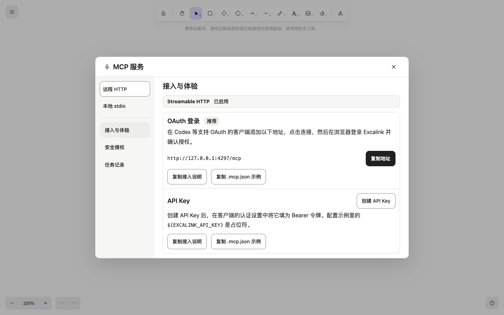

# Excalink

[简体中文](README.md) · English

Excalink is a self-hosted personal whiteboard built on Excalidraw. Open the home page to keep drawing, save a copy to your archive, or share an edit link to work together. AI clients can create and edit diagrams on the current canvas via MCP.


- **Keep drawing** — The server saves the current canvas automatically so you can pick up after a refresh.
- **Archive boards** — Save a copy at a stable URL, then find, open, rename, or delete it in the archive.
- **Collaborate by link** — Guests edit the same board with you in real time. After you start a new board, the link still points to the archived board, and the owner can revoke it at any time.
- **Connect AI tools** — Connect via remote Streamable HTTP or local stdio to read and edit the current canvas, convert Mermaid diagrams, and export PNG or SVG. Remote clients can sign in via browser OAuth or use an API key. Both transports support read-only access.

<details>
<summary>See the archive, sharing, and MCP screens</summary>

**Board archive**


**Share the current board**


**MCP Service**



</details>

## Quick start

You need Git, Docker, and Docker Compose v2.

```sh
git clone https://github.com/xiongwei-git/Excalink.git
cd Excalink
docker compose up -d --build
```

Open <http://127.0.0.1:4173>. By default, Excalink listens on loopback and grants owner access to anyone who can reach it. For a private whiteboard on a public host, configure password or OIDC authentication before enabling HTTPS access.

The [deployment guide](docs/deployment/README.en.md) covers Docker, Node.js, authentication, Nginx and BaoTa, and backups. To connect an AI client, see [MCP setup](docs/deployment/README.en.md#connect-mcp) and the [MCP compatibility reference](docs/MCP_COMPATIBILITY.md).

## License

Excalink’s own source code is licensed under the [MIT License](LICENSE). Excalidraw, other third-party dependencies, and fonts are covered by their respective licenses. See the [third-party notices](notices/README.md) for details.
