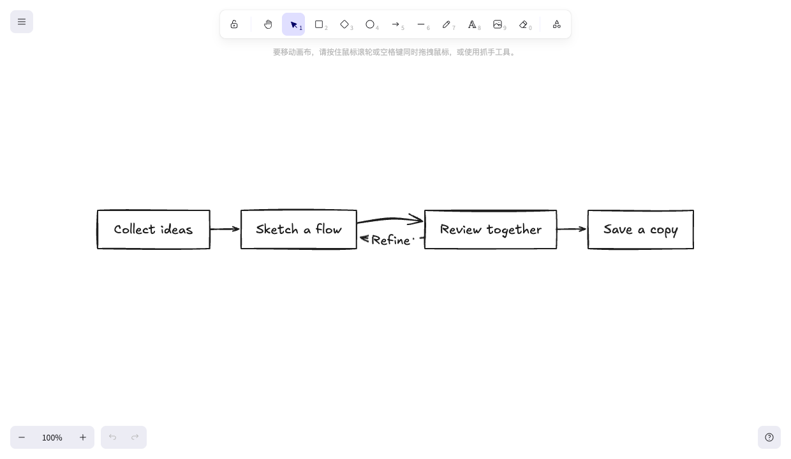
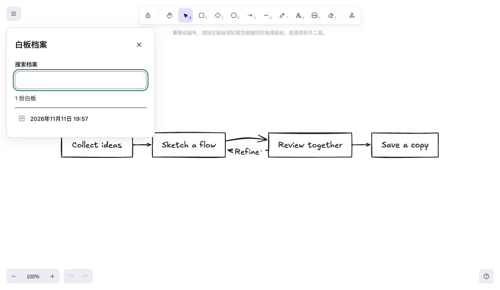
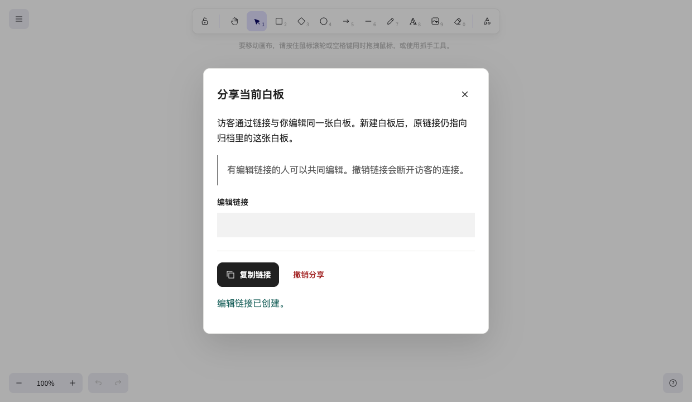

# Excalink

[简体中文](README.md) · English

Excalink is a self-hosted personal whiteboard built on Excalidraw. Open the home page to keep drawing, save a copy to your archive, or share an edit link to work together. AI clients can create and edit diagrams on the current canvas via MCP.



- **Keep drawing** — The server saves the current canvas automatically so you can pick up after a refresh.
- **Archive boards** — Save a copy at a stable URL, then find it in the searchable archive.
- **Collaborate by link** — Share a separate copy of the current canvas. Guests can edit it together, and the owner can revoke the link.
- **Connect AI tools** — MCP clients can read and edit the current canvas, convert Mermaid diagrams, and export PNG or SVG.

<details>
<summary>See the archive and sharing controls</summary>

**Board archive**



**Share a copy**



</details>

## Quick start

You need Git, Docker, and Docker Compose v2.

```sh
git clone https://github.com/xiongwei-git/Excalink.git
cd Excalink
docker compose up -d --build
```

Open <http://127.0.0.1:4173>. By default, Excalink listens on loopback and grants owner access to anyone who can reach it. For a private whiteboard on a public host, configure password or OIDC authentication before enabling HTTPS access.

The [deployment guide](docs/deployment/README.en.md) covers Docker, Node.js, authentication, Nginx and BaoTa, and backups. To connect an AI client, see [MCP setup](docs/deployment/README.en.md#connect-mcp) and the [MCP compatibility reference](docs/MCP_COMPATIBILITY.md).

## License

Excalink’s own source code is licensed under the [MIT License](LICENSE). Excalidraw, other third-party dependencies, and fonts are covered by their respective licenses. See the [third-party notices](notices/README.md) for details.
