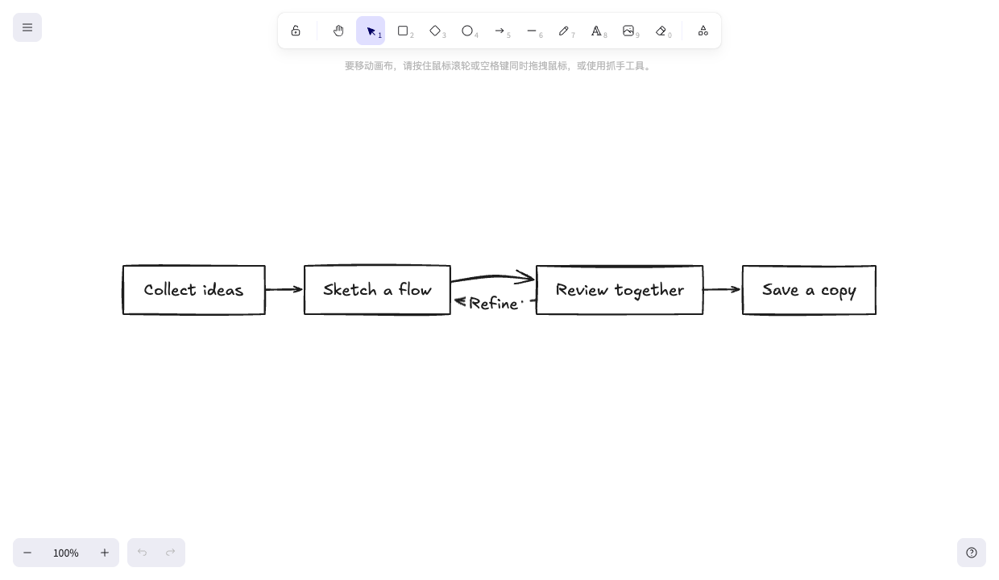
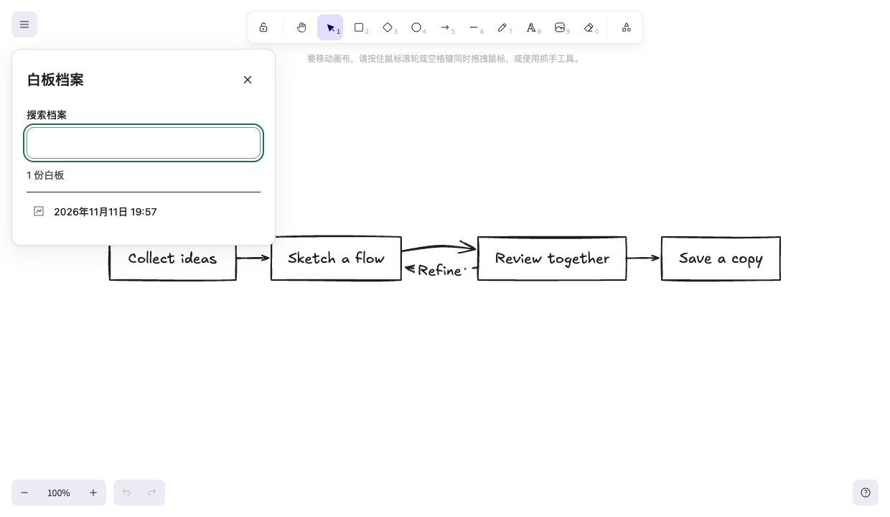
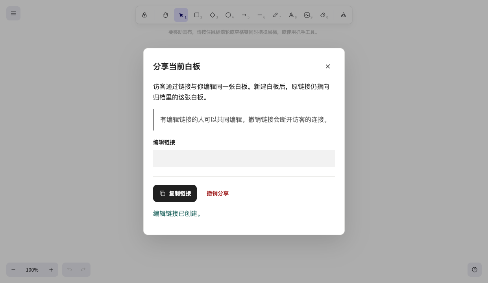

# Excalink

简体中文 · [English](README.en.md)

Excalink 是基于 Excalidraw 的自托管个人白板。打开首页继续画图，保存副本留档，或发出编辑链接和别人一起改。AI 客户端可以通过 MCP 在当前画布上生成和编辑图形。



- **持续绘图** — 当前画布自动保存到服务端，刷新后可以继续编辑。
- **保存档案** — 将画布另存为有固定地址的白板，从档案中搜索和打开。
- **分享协作** — 从当前画布创建独立共享副本。访客凭链接共同编辑，所有者可以撤销链接。
- **连接 AI** — MCP 客户端可读写当前画布、转换 Mermaid，并导出 PNG 或 SVG。

<details>
<summary>查看档案与分享界面</summary>

**白板档案**



**分享副本**



</details>

## 快速开始

需要 Git、Docker 和 Docker Compose v2。

```sh
git clone https://github.com/xiongwei-git/Excalink.git
cd Excalink
docker compose up -d --build
```

打开 <http://127.0.0.1:4173>。默认仅监听本机，能访问服务的人都可管理白板。对外部署私人白板前，先配置密码或 OIDC，再启用 HTTPS。

[部署指南](docs/deployment/README.md)涵盖 Docker、Node.js、三种认证模式、Nginx / 宝塔反代和备份。连接 AI 请参阅 [MCP 配置与工具](docs/deployment/README.md#连接-mcp)及 [MCP 兼容表](docs/MCP_COMPATIBILITY.md)。

## 许可证

Excalink 自有源码采用 [MIT 许可证](LICENSE)。Excalidraw、其他第三方依赖与字体适用各自的许可证，详见[第三方归属与许可](notices/README.md)。
